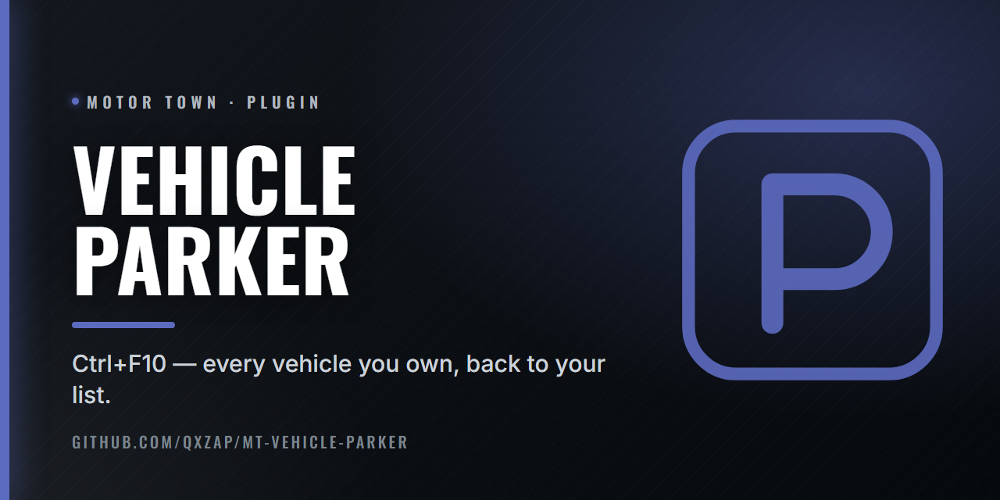

  

# Vehicle Parker

Plugin to park all cars.

Press Ctrl+F10 in game: every vehicle you own goes back to your vehicle list, through the game's own Despawn. Nothing is deleted, campers stay where they are, and other players' vehicles are never touched.

## Install

Needs [Plugin Loader](https://github.com/qxZap/mt-plugin-loader) (`version.dll`) in
`MotorTown\Binaries\Win64\`. Put `mt_plugin_VehicleParker.dll` in `MotorTown\Binaries\Win64\plugins\`.

## Build

`build.bat` (MSVC 2022, x64) writes `out\mt_plugin_VehicleParker.dll`.
